# 如何将 ESP32 变为 SDR？——ESP-SDR 介绍

50 块不到，能买到一台 SDR 吗？ESP-SDR 给出的答案很特别：它没有增加新的射频硬件，而是把 ESP32 已有的 Wi-Fi／蓝牙射频链路中、原本未公开给开发者的调试数据通路接了出来，让电脑能看到接收机内部的原始 I/Q 样本。

截至 2026 年 10 月 31 日，ESP-SDR 已获得 1185 个 Star 和 167 个 Fork[1]。但 50 块不到买到的不是一个全功能通用 SDR，而是一个受“片上缓冲、外部接口、射频前端”三重约束的调试入口。本文按一条 I/Q 样本从天线到电脑的旅程，解释它能做什么、为什么不同型号的“连续”不是一回事，以及该怎么选。

[1] 数据截至 2026 年 10 月 31 日。Star／Fork 数会变化，此处仅作项目热度参考。

## 项目简介

### 什么是 ESP-SDR？

ESP-SDR 是一套开源固件及配套工具。官方主线以接收为主，利用受支持 ESP32 芯片已有的 Wi-Fi／蓝牙射频硬件，采集接收机内部的原始 I/Q 数据，再通过 USB 或 UART 发送给电脑，无须外加传统 SDR 接收机。

需要区分的是，官方主线与衍生项目的能力并不完全相同。官方主线主要解决“拿得到原始样本”；连续 I/Q、高速流式输出和发射等能力，分布在不同芯片、固件或关联项目中。例如，[esp-sdr-zephyr](https://github.com/cyber-murmel/esp-sdr-zephyr) 已经加入 I/Q 发射，并实现了 Gqrx、GNU Radio 接入以及多种通信协议实验。因此，这条调试通路带来的不只是“隐藏接收能力”，更是一个可以由软件直接操控的底层射频数据入口。

换句话说，ESP-SDR 并没有给 ESP32 增加新的射频硬件，而是把芯片中原本已经存在、却没有公开给开发者的射频数据通路“接”了出来。

### ESP-SDR 能做什么？

ESP-SDR 最直观的玩法，是把 ESP32 当成一个简易频谱仪：打开配套的 [ESP-WebSDR 网页](https://espargos.net/espsdr/app/index.html)，调整接收频率，查看频谱和瀑布图，观察 2.4 GHz 附近的无线信号；使用 ESP32-C5 时，还能接收 5 GHz 频段。

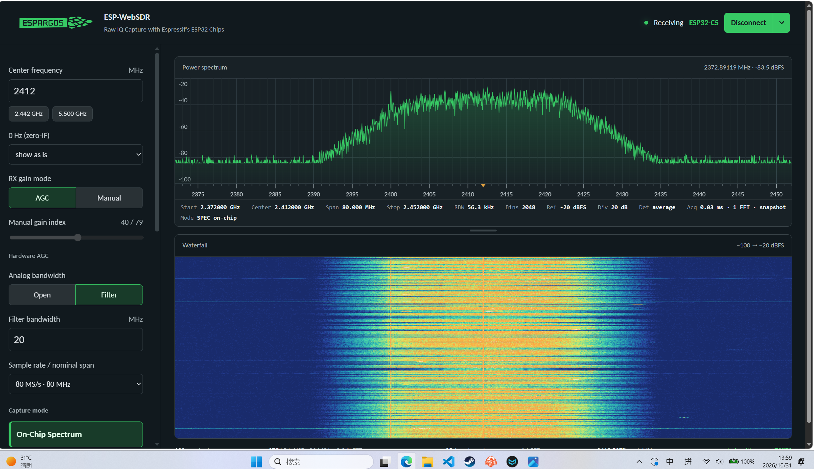

> 图：ESP-WebSDR 中的频谱与瀑布图，使用片上 FFT 模式。

再深入一些，可以获取原始 I/Q 采样，用于信号记录、离线分析和无线电实验。

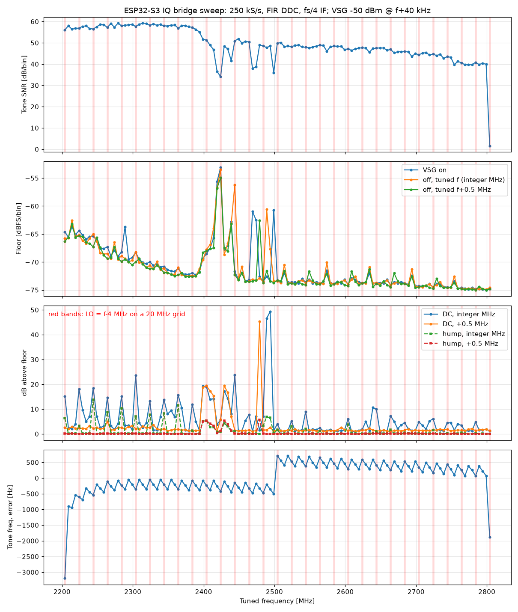

> 图：对 I/Q 采样进行离线分析。

除快照式采集外，部分型号还支持连续 I/Q 输出或流式传输。ESP32-S3 可以将 I/Q 数据滤波、抽取后连续输出；ESP32-S31 则可配合实验性流式固件和 [SoapyESPSDR](https://github.com/ESPARGOS/SoapyESPSDR)，通过 USB 或千兆以太网接入 Gqrx、GNU Radio 等桌面 SDR 软件。其中，S31 目前最高支持 20 MSa/s 的 USB 连续接收或 40 MSa/s 的以太网连续接收。

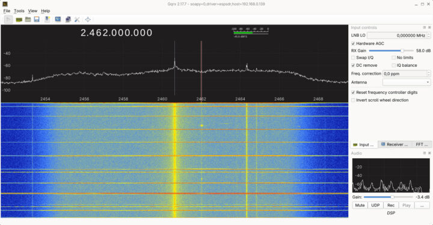

> 图：ESP32-S31 通过 SoapyESPSDR 接入 Gqrx，显示 2.462 GHz 附近的频谱与瀑布图。

### 目前有哪些不足与局限？

ESP-SDR 虽然发展迅速，但目前仍不能简单视作一块全功能通用 SDR，主要限制在于：

1. **原生频率覆盖有限，扩展接收需要额外前端。** ESP32 自身主要覆盖 2.4 GHz 附近，ESP32-C5 还可以接收 5 GHz 信号，无法直接覆盖短波、FM 广播以及 144／430 MHz 等频段。社区已在探索类似 HackRF 的外接混频方案：先将其他频段的信号变频到 ESP32 能够接收的范围，再交给 ESP-SDR 采集和处理。代价是需要增加本振、混频、滤波等外部硬件，系统的成本、性能和使用复杂度也会更多取决于变频前端。原因见原理第四关。

2. **片内采样率不等于电脑能够持续获得的 I/Q 带宽。** 芯片内部虽然可以达到最高 80 MS/s，但不少工作模式仍采用快照式采集，快照之间存在间隔；部分型号虽然支持连续频谱采集，也不代表芯片会对所有采样进行实时 FFT 分析。连续 I/Q 输出的速率则取决于具体型号、固件以及 USB 或网络接口。原因见原理第一至第三关。

3. **各项能力尚未整合成统一、一致的使用体验。** 官方主线固件以接收为主，连续 I/Q、高速流式输出和发射等能力分布在不同芯片、固件或关联项目中。例如，esp-sdr-zephyr 已经实现 I/Q 发射和多种通信实验，S31 流式固件则专注于高速连续接收，但这并不意味着任意支持型号刷入同一固件后，都能同时获得这些功能。原因见原理小结与衍生项目。

4. **射频性能与校准仍主要面向实验用途。** ESP32 的射频前端原本服务于 Wi-Fi／蓝牙通信，并非通用宽频 SDR 前端；项目文档也明确指出增益未经过 dB 校准。因此，它适合观察频谱、研究信号和开展协议实验，但不应直接当作精密射频测量仪器。原因见原理第四关。

ESP-SDR 的价值，在于把 ESP32 已有的射频硬件变成低成本的频谱观察与 I/Q 采集入口。它并不是全功能 SDR 的直接平替，但围绕这个入口，已经出现了连续接收、信号发射、协议测试和外接变频等更多玩法。

## ESP-SDR项目背景与发展

ESP-SDR 起源于 ESPARGOS 团队的无线信道测量研究。Florian Euchner 与 Marc Gauger 希望用低成本的 ESP32 替代专业 SDR，构建多通道信道探测平台。在逆向 ESP32 射频链路时，团队从乐鑫 `librftest` 库的 `adctrig` 函数入手，并借助 LLM 找到一条未公开的调试通路，使 CPU 能够直接读取原始 I/Q 采样，ESP-SDR 也由此诞生。

2026 年 9 月底，团队以 GPL-3.0-or-later 开源 ESP-SDR，初始版本主要用于接收和快照式频谱观察。随后，项目逐步扩展芯片支持，并加入 ESP32-S3 连续 I/Q 输出和 ESP32-S31 实验性流式接收；ESP-WebSDR、SoapyESPSDR 等工具则分别降低了浏览器上手和桌面 SDR 软件接入的门槛。

10 月，marble（Murmel）发布 esp-sdr-zephyr，进一步实现 I/Q 发射、GNU Radio／Gqrx 接入和通信协议实验，使 ESP32 SDR 从频谱观察扩展到更多收发与通信研究场景。

与此同时，h0m3us3r 几乎同期独立发现了类似机制并开发 eSpDR，C5VRX 则从 5.8 GHz FPV 视频接收切入。它们并非简单的前后继承关系，而是社区沿不同路线进行探索，并在公开后相互借鉴，共同推动了 ESP32 SDR 玩法的发展。

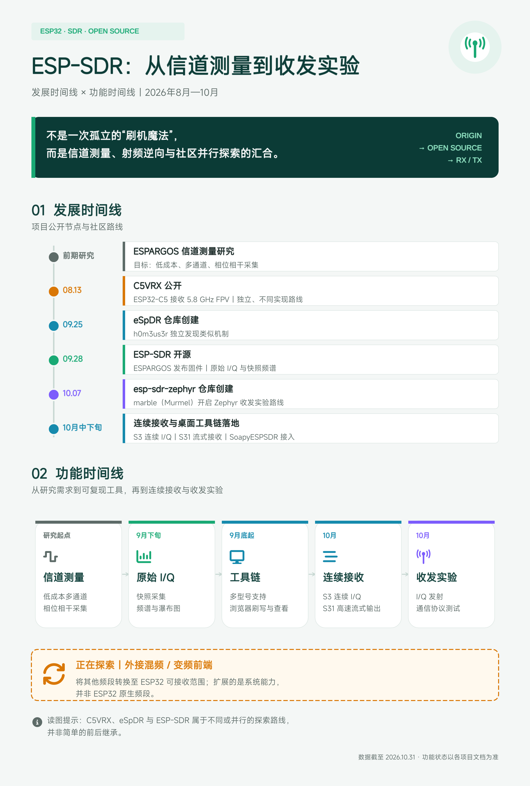

> 图：ESP-SDR 发展与功能时间线。时间线只表示社区路线出现顺序，不代表能力继承关系；具体能力仍要按芯片、固件和接口确认。

## ESP-SDR 的 I/Q 采集原理

无论走 ESP-SDR、eSpDR、C5VRX 还是 esp-sdr-zephyr，一条 I/Q 样本从天线到电脑，基本都要经过同一类环节。这些路线共享的 I/Q 采集通路，既决定了样本要过哪几道关，也决定了不同芯片、固件和接口下的能力边界。沿这条通路，可以依次追问四个问题：样本先存在哪、CPU 能不能及时读走、外部接口能不能送出，以及前端能不能测得准。下面逐段拆开看。

### 第一关：采集——快照为什么有间隙

ESP-SDR 没有增加新的射频硬件，而是把接收机原有的调试数据通路接到软件可见的内存中。固件先通过正常的 Wi-Fi（H2 为蓝牙）初始化打开并调谐射频，再从 `librftest` 的 `adctrig` 等逆向线索出发，配置未公开调试寄存器，选择 I/Q lane、移交 SRAM 所有权并触发采集。天线信号经 RF 前端、下变频和 ADC 后，复数基带样本一路进入正常调制解调器，另一路由 sample-dump engine 写入 SRAM；CPU 随后读回并经 USB 或 UART 转发。

每个原始样本占一个 32 bit 字，其中 I、Q 各为 10 bit 有符号数，并带有接收增益索引。由于取样点在 Wi-Fi 滤波和解调之前，观察到的不限于 Wi-Fi 帧，而是接收机通带内的信号。官方采集说明见 [how-it-works.md](https://github.com/ESPARGOS/esp-sdr/blob/main/docs/how-it-works.md)。

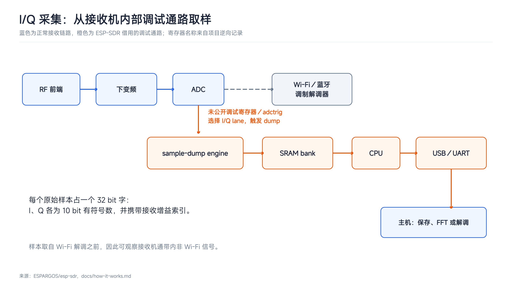

> 图：正常协议栈仍可用于初始化和调谐，但样本不再必须经过它；调试通路在 ADC 后分叉，把原始基带数据直接交给 CPU。

这第一步解决的是“能不能拿到原始样本”，还没有解决“能不能连续拿”。最直接的采集方式是快照：触发 dump，等 sample-dump engine 把一段样本写进 SRAM，然后停止采集、把 SRAM 还给 CPU，再读回和转发。80 MS/s 时采满 16,380 个样本约需 205 µs，但这只是 dump engine 的写入时间；停止采集后的读回、转发和重新配置同样要花时间，因此快照之间必然存在接收间隙。

快照能拿到原始 I/Q，但它是低占空比的。你看到的是一段一段的样本，而不是一条永不中断的流。前文所说的“片内采样率不等于电脑能够持续获得的 I/Q 带宽”，第一层原因就在这里。要减少固定停采点，就得让 dump engine 循环写——这就是第二关。

### 第二关：片上缓冲——环形模式也不是无限连续

为了减少固定停采点，环形模式让 dump engine 循环写入，并利用写指针和 bank 所有权切换，使 CPU 在硬件写另一块时处理上一块。

但不同型号的缓冲组织并不相同：C6／C61 使用双 bank，S3 使用三 bank，不能把所有型号都概括成同一种双缓冲。环形模式消除了“停采后读回”的固定间隙，却引入了严格的处理截止时间：如果 CPU 未能在写指针返回前归还 bank，未读样本就会被覆盖。固件必须报告 gap 或 overrun，而不能把损坏数据当作连续流。

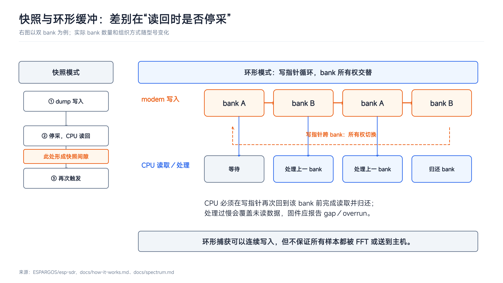

> 图：快照间隙来自“停采后读回”；环形模式消除了这一固定停采点，但引入了严格的处理截止时间。没有 gap／overrun 报告的“连续”无法验证。

所以，环形模式不是“无限连续”的同义词。它只是把压力从“停采读回”转移到了“CPU 能否在截止时间前处理完上一块”。CPU 处理完还得送出去——这就是第三关。

### 第三关：输出接口——2.56 Gbit/s 撞上 UART／USB

即使片上环形缓冲能持续写，瓶颈也会很快转移到外部接口。

按原始内存字计算，80 MSa/s × 32 bit 相当于 2.56 Gbit/s 的 dump 写入速率，而主线协议常用 UART 2 Mbaud，USB Serial／JTAG 和全速 USB 的标称链路速率也只有 12 Mbit/s。这个对比不是主机有效载荷的实测值，却足以说明数量级差距：裸芯片无法把最高速原始流原样送出。

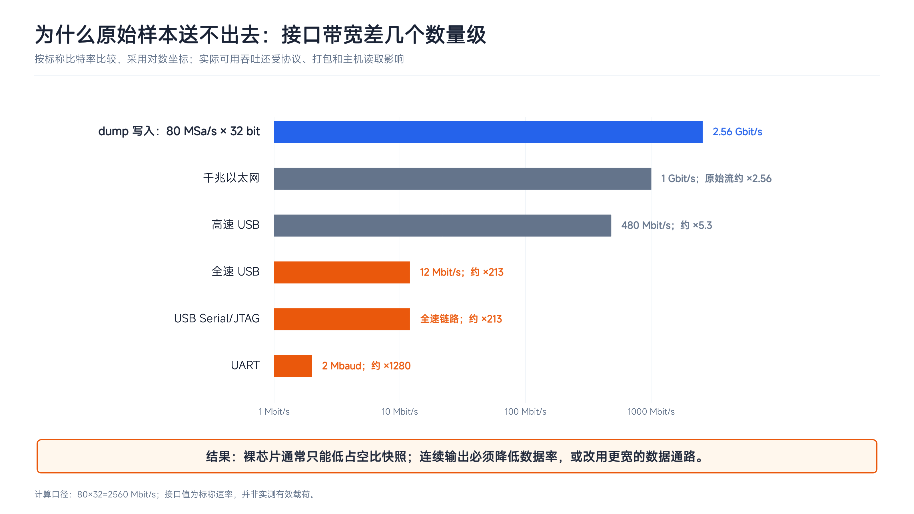

> 图：提高 ADC 侧采样率不会自动扩大主机可见带宽；真正需要匹配的是样本格式、处理链和输出接口的总数据率。

因此，实际方案只能分成几类：低占空比快照、片上 FFT 后只传频谱 bins，或先滤波抽取再传低速 I/Q。也正因为如此，“连续采集”至少有三层含义，不能混为一谈。

其一是**裸芯片上的有限连续低速 I/Q**：S3 在 16 MS/s 环形输入上进行滤波和 64～1024 倍抽取，经原生 USB 输出 15.625～250 kS/s 的无间隙低速 I/Q，而不是连续输出 80 MS/s 原始样本。见 [S3 流式说明](https://github.com/ESPARGOS/esp-sdr/blob/main/docs/iq-stream.md)。

其二是**芯片原生高速流**：S31 实验性固件不再走 SRAM 快照，而把内部调试总线经 GPIO matrix 回环到 PARLIO，由 DMA 连续接收每样本 8 bit I＋8 bit Q；官方当前口径为高速 USB 最高 20 MSa/s、千兆以太网最高 40 MSa/s。见 [S31 流式说明](https://github.com/ESPARGOS/esp-sdr/blob/main/docs/s31-streaming.md)。

其三是**外挂系统级连续流**：eSpDR 让 S3 通过 16 条 GPIO 把样本送给 FPGA，由 FPGA 完成重组、DDR3 缓冲和无损压缩，再经 FT600 USB 3 送往主机，达到 80 MSa/s。这是整个系统的能力，不是 ESP32 裸芯片接口能力。见 [eSpDR 项目说明](https://github.com/h0m3us3r/eSpDR)。

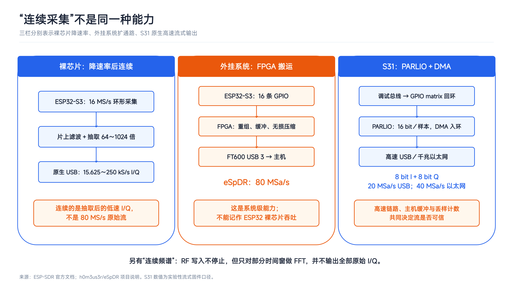

> 图：三条路线分别通过降低数据率、增加外部搬运与缓冲、改用片上并行 DMA 通路解决瓶颈，所得“连续”的对象并不相同。

还要特别提醒：C6、C61、S3、S31 的“连续频谱”只表示 RF 写入不停止，CPU 仍只分析部分 FFT 时间窗，不能等同于原始 I/Q 连续输出。接口决定了你能送多快，但送得出去不等于测得准——这就是第四关。

### 第四关：射频前端——送得出去，也未必测得准

即使样本能够连续送出，射频质量仍受零中频架构约束：直流偏移和本振馈通形成中心尖峰，I/Q 幅度或相位不平衡产生镜像；主线增益又未做 dB 校准，所以增益索引不能直接当作绝对功率。

频率覆盖同样由前端决定。主要型号工作在 2.4 GHz 附近，C5 还可接收 5 GHz；短波、FM 广播或 144／430 MHz 需要外接混频、滤波和本振，代价与校准负担也随之转移到外部前端。社区已经在探索类似 HackRF 的外接混频方案：先把其他频段变频到 ESP32 能够接收的范围，再交给 ESP-SDR 采集和处理；但系统成本、性能和使用复杂度会更多取决于变频前端。

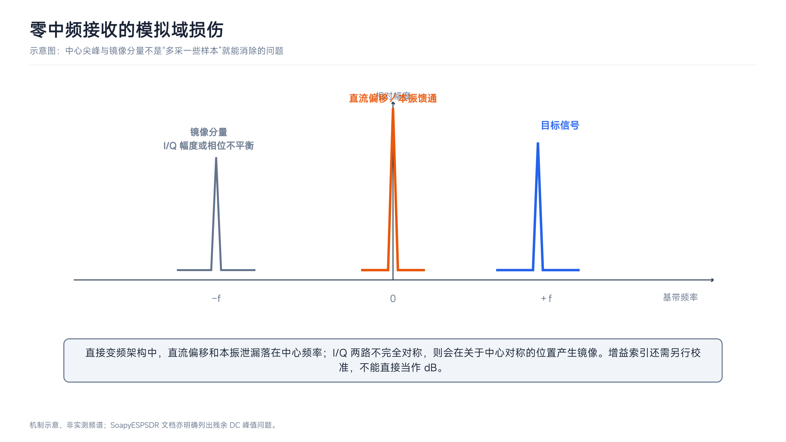

> 图：中心尖峰与镜像分别对应直流相关误差和 I/Q 不平衡，它们属于模拟及校准问题，与接口带宽相互独立。

这解释了前文所说的频率覆盖和测量精度局限：ESP32 的射频前端原本服务于 Wi-Fi／蓝牙通信，并非通用宽频 SDR 前端；它适合观察频谱、研究信号和开展协议实验，但不应直接当作精密射频测量仪器。到这里，四关合在一起才构成完整的能力边界：能采到、能持续读走、能送出去，还要能测得准；任何一环受限，都不能用单一的采样率数字概括。

#### 获取与使用 ESP-SDR

ESP-SDR 的获取方式主要有两种：用浏览器刷官方固件，适合快速体验；从源码构建官方主线固件，适合需要改代码或调参数的人。

### 基于 Web 快速下载

如果只是想快速体验 ESP-SDR，这是官方主推、门槛最低的方式，只需两步：**浏览器刷固件 → 浏览器打开查看器连接**。

1. 准备一块受支持的 ESP32 开发板，用 USB 连接电脑。

2. 打开 Chrome 或 Edge，访问官方固件安装器 `https://espargos.net/espsdr/app/flash.html`，按页面提示检测芯片并安装匹配固件。连接失败时，按住 BOOT 再点 RESET 进入下载模式后重试。
   
   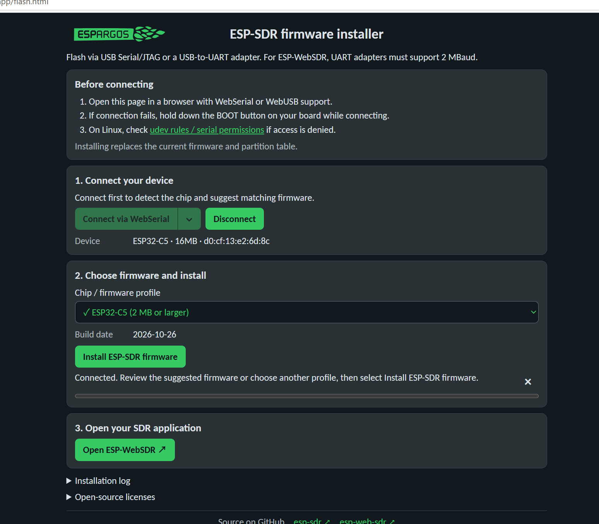
   
   > 固件烧录

3. 刷完后拔插一次 USB，等待几秒重新上电，打开 `https://espargos.net/espsdr/app/` 连接设备，即可看到频谱和瀑布图。
   
   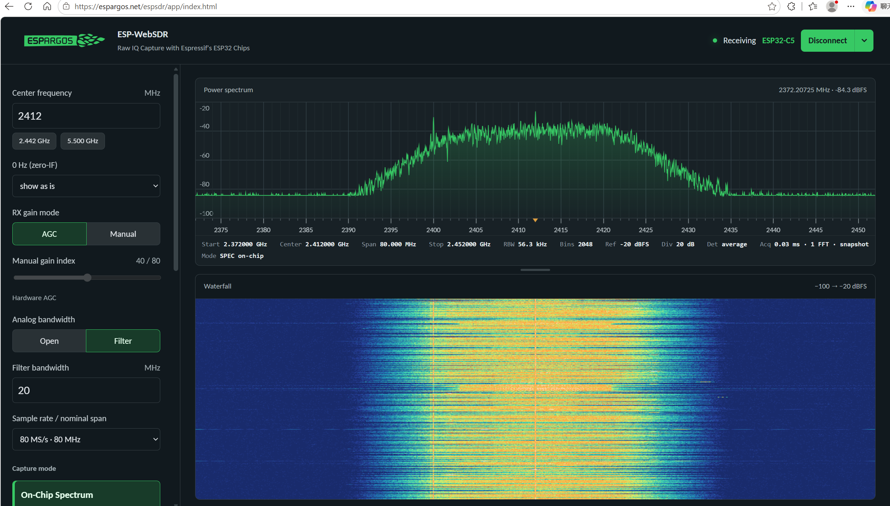
   
   > 网页端绘制ESP-SDR频谱和瀑布图

### 从源码构建官方主线固件

需要改代码、换芯片支持、调采集参数，或使用尚未进入浏览器安装器的官方分支时，才需要自行构建。官方主线基于 ESP-IDF；如果只是使用官方主线，优先走 Web 安装器，不必自己编译。

以 ESP32-C5 为例，命令如下：

```bash
idf.py set-target esp32c5
idf.py build
idf.py -p COMx flash monitor
```

或者通过VS Code ESP-IDF插件进行构建

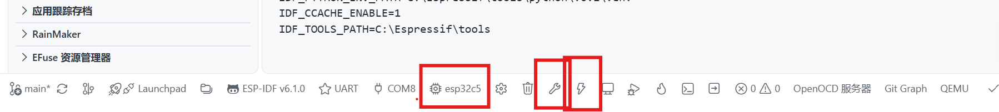

> 图：VS Code 中 ESP-IDF 插件的状态栏快捷操作
> esp32c5（芯片图标）：目标芯片选择。显示当前编译目标，点击可切换芯片（等同于 idf.py set-target）。
> 扳手图标：项目构建（Build）。点击执行编译（等同于 idf.py build）。
> 闪电图标：烧录固件（Flash）。点击通过串口将固件写入开发板（等同于 idf.py flash）。

注意：不同版本的 ESP-IDF 对芯片的支持程度不同（例如 ESP32-C5 从 v5.5 开始提供初步支持，在 v6.0 中转为完整支持），使用前建议查阅官方兼容性表格确认。

## 基于 ESP-SDR 衍生项目

官方主线解决“拿得到原始样本”。下面这些项目分别解决输出接口、桌面软件接入、连续流和发射；它们不是同一固件里的功能开关，不能默认“任意支持型号刷同一固件就获得全部能力”。

## 基于 ESP-SDR 的衍生项目

官方主线解决“拿得到原始样本”的问题，而下面这些社区项目分别扩展了输出接口、桌面软件接入以及收发能力。它们并非同一固件里的功能开关，使用前需确认对应的分支和芯片支持。

### zephyr_esp_sdr

- **定位**：将 ESP-SDR 的射频调试通路移植到 Zephyr RTOS 的**模块化软件定义无线电平台**。主力平台是 ESP32-S3，同时向 ESP32-C6 和 C5 延伸。

- **芯片分工**：
  
  - **ESP32-S3（主力）**：项目的核心平台。支持原始 I/Q 接收与发射，`osmosdr`、`stream`、`wpan`、`zstack`、`chancap`、`ubertooth` 等全部应用都以 S3 为运行基础。
  - **ESP32-C6 / C5（延伸节点）**：支持**突发捕获（burst capture）** 和**最高 250 kS/s 的 CPU-paced 连续收发**，通过 `esp_sdr_paced.h` 实现；`osmosdr_serial` 让它们以 USB-Serial-JTAG 方式接入 SDR 软件。
  - **ESP32-C5（片内连续补充）**：额外通过 modem diagnostic bus 实现 **40 MS/s 的无间隙环形缓冲**（`esp_sdr_diag.h`），并可用 DAC 引擎以 80/40 MS/s 回放波形（`esp_sdr_replay.h`）。需要区分：这条 40 MS/s 环形通路服务于**片上实时处理**；250 kS/s 的 CPU-paced 连续流才是主机侧可用的低速连续输出。

- **应用形态**（`apps/` 下的模块，可在 `multiapp` 中按需切换）：
  
  | 应用               | 用途                                    |
  | ---------------- | ------------------------------------- |
  | `osmosdr`        | HackRF 风格 USB SDR，接入 GNU Radio / Gqrx |
  | `osmosdr_serial` | 同上，走 USB-Serial-JTAG（C6、C5）           |
  | `stream`         | VITA 49.2 格式的 RX/TX over USB（CDC-NCM） |
  | `wpan`           | 802.15.4 测试 shell                     |
  | `zstack`         | Zigbee 协调器（Z-Stack ZNP 串口协议）          |
  | `chancap`        | 按信道网格逐包捕获，输出 VITA 49.2                |
  | `ubertooth`      | Ubertooth One 设备固件，配合上游主机工具           |
  | `multiapp`       | 一个固件包含上述多个应用                          |

- **核心价值**：
  
  - **S3 上的收发闭环**：接收 I/Q 捕获 + 发射 DAC 回放，配合 802.15.4 O-QPSK PHY 和 `wpan`/`zstack`，可直接做从物理层到协议栈的收发验证。
  - **多芯片的统一抽象**：同一套 API（`esp_sdr.h`、`esp_sdr_rx.h`、`esp_sdr_tx.h`、`esp_sdr_paced.h`、`esp_sdr_diag.h`）覆盖 S3、C6、C5，应用层无需为每颗芯片重写。
  - **与桌面 SDR 生态直接对接**：`osmosdr`/`osmosdr_serial` 让 ESP32 被 GNU Radio、Gqrx、SoapySDR 识别为标准 SDR 源，配套的 SoapySDR 模块随 Release 发布。

- **项目地址**：`https://github.com/cyber-murmel/esp-sdr-zephyr`

### esp-sdr-bridge

- **定位**：解决 ESP32-S3 在桌面 SDR 软件（SDR++、SDR#、Gqrx、GNU Radio 等）中的接入问题，通过 PC 端桥接程序，让 ESP32 变为标准的网络 SDR 源。

- **原理与分工**：
  
  - **ESP32-S3（片上处理）**：一个核心维持 16 MS/s 的高速环形缓冲采集；另一个核心同步执行两阶抽取 FIR（数字下变频 DDC），将数据率大幅降低。
  - **接口瓶颈与输出**：由于 S3 的 USB Serial/JTAG 实际有效载荷仅约 0.65 MB/s，无法原样送出 16 MS/s 的原始流。因此，片上抽取后提供三档 **250 kS/s (8-bit)**、**125 kS/s (16-bit)** 或 **62.5 kS/s (16-bit)** 的无间隙低速 I/Q 流。
  - **PC 端桥接（协议转换）**：桥接程序读取 USB 数据流，将其重新打包成标准的 **SpyServer** 或 **rtl_tcp** 网络协议，从而“骗过”各类桌面 SDR 软件。

- **应用接入**：
  
  | 软件生态                     | 协议        | 默认地址                     |
  | ------------------------ | --------- | ------------------------ |
  | SDR++ / SDR#             | SpyServer | `localhost:5555` (Int16) |
  | SDR++ / Gqrx / GNU Radio | RTL-TCP   | `localhost:1234`         |

- **核心价值**：
  
  - **无缝融入现有工作流**：不要求用户更换软件，直接让 ESP32 被主流 SDR 软件识别为标准网络 SDR 源，极大降低了上手门槛。
  - **把接口瓶颈变成选项**：片上智能抽取提供三档速率选择，在带宽和动态范围（8-bit vs 16-bit）之间把决定权交给用户。
  - **局域网共享**：转换为网络协议后，同一局域网内的手机、平板或另一台电脑都能连接这块 ESP32，实现远程接收。
  - **真实的“连续”**：输出的是主机能实际接收的无间隙低速 I/Q 流。如果看到 `gap` 报告，说明 CPU 或 USB 链路没跟上，这正是前文“环形缓冲处理截止时间”在外部接口上的体现。

- **项目地址**：`https://github.com/z2labs/esp-sdr-bridge`

## ESP32-C5 无线勘察工具：在 ESP-SDR 之上补的三步

基于开源项目 **ESP-SDR**，参考 **zephyr_esp_sdr / esp-sdr-bridge**，实现了一个 ESP-SDR 的 GUI 调试工具。项目的出发点并不是做一个“频谱工具”，而是想给 ESP-SDR 补上它缺的半个能力：**协议栈抓包**。后续又沿着其他平台和项目的做法，逐步补出了连续采样和桌面 SDR 软件接入。

一句话概括：

> 围绕 ESP-SDR 补齐三块能力：**协议栈抓包、连续采样、桌面 SDR 软件接入**，并用一个 GUI 调试工具串起来。

三步演进：

1. **扩展协议栈抓包**：在原始 I/Q 之外，把 Wi-Fi / BLE 协议栈的报文抓下来，存 pcap，接 Wireshark。

2. **移植连续采样**：解决上游 C5 只有快照 `CAP16`、快照之间有间隙的问题，在 C5 上实现无间隙的 10k–80k S/s。

3. **接入桌面 SDR 软件生态**：在主机侧实现 libiio/iiod 的 PlutoSDR 模拟，让 SDR# 通过 PlutoSDR 源连接 `ip:127.0.0.1`，支持python libiio/matlab控制（）。

### 第一步：扩展协议栈抓包（Wi-Fi / BLE Monitor）

ESP-SDR 只给了 I/Q；协议栈能给出"帧"。这一层要做的就是把这半个能力接出来，而且不破坏原来的 SDR 通路。

- **模式互斥**：SDR 频谱 / Wi-Fi 监控 / BLE 监控 / SDR# 桥接，同一时刻只有一个"主人"。射频前端只有一个：SDR 要让 PHY 进 RX 测试模式，监听要把 PHY 交给协议栈，这两种状态没法共存，所以切换前必须 STOP。
- **统一协议**：命令是文本行（`MON*`、`IQS*`、`SPEC`、`CAP16` …），数据是二进制帧（`SPC1`、`DATA`、`WIFIFRAME`、`BLEFRAME`、`IQFRAME`），都走同一条 USB-Serial-JTAG。
- **Wi-Fi 侧只做最轻的活**：`esp_wifi_set_promiscuous(true)` 之后，回调里只取 RSSI／信道、拼 15 字节 Radiotap、把整帧丢进 PSRAM 帧池；组包发送交给独立任务。回调里做重处理会直接掉帧。
- **BLE 侧是被动扫描**：NimBLE 只收广播包，不发 `SCAN_REQ`，不会在空口上暴露自己。C5 的控制器固定同时扫 37/38/39，所以 pcap 里的信道字段统一填 37——这是硬件限制，不是 bug。
- **抓到的就是标准格式**：Wi-Fi 帧带 Radiotap（pcap linktype 127）、BLE 是完整广播 PDU（linktype 256），Wireshark 直接打开；不想落盘就连命名管道实时看。
- **一个工具、零安装**：双击就能连板子，不需要 Python 环境或 ESP-IDF。

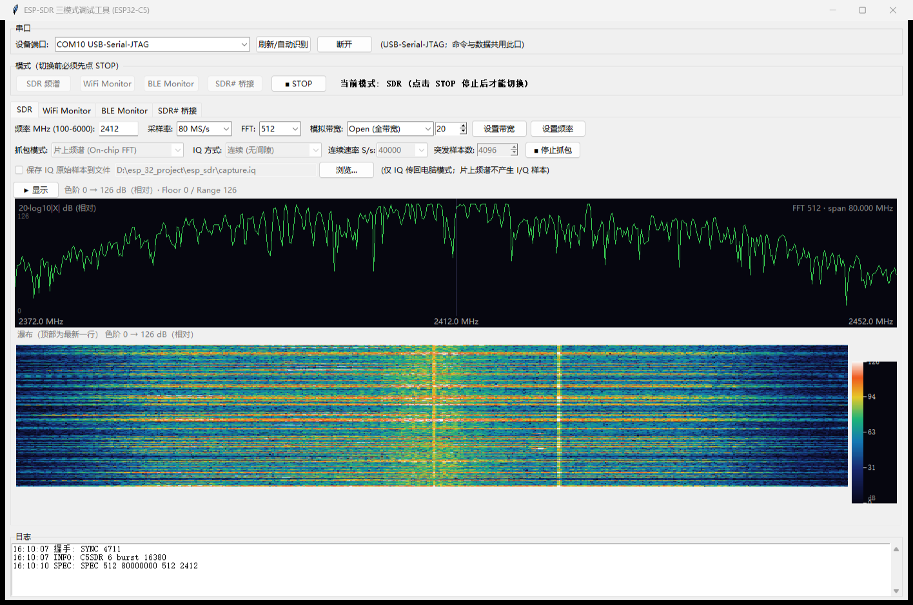

> 图：SDR 模式（片上 FFT，512 bin）。上方是 2.4 GHz 中心的频谱，下方是瀑布，右侧是功率色标（`code = 20·log10|X|` 的相对值，可用 Floor/Range 拉伸）。

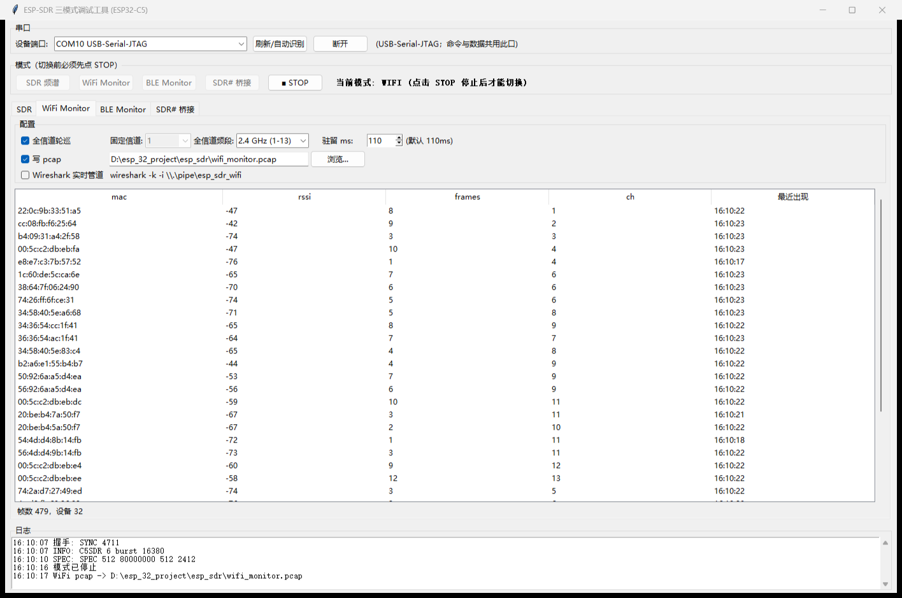

> 图：Wi-Fi Monitor（2.4 GHz 全信道轮巡，驻留 110 ms）。右侧按 BSSID 汇总 RSSI／帧数／信道；同时把 Radiotap + 完整 802.11 帧写进 pcap。

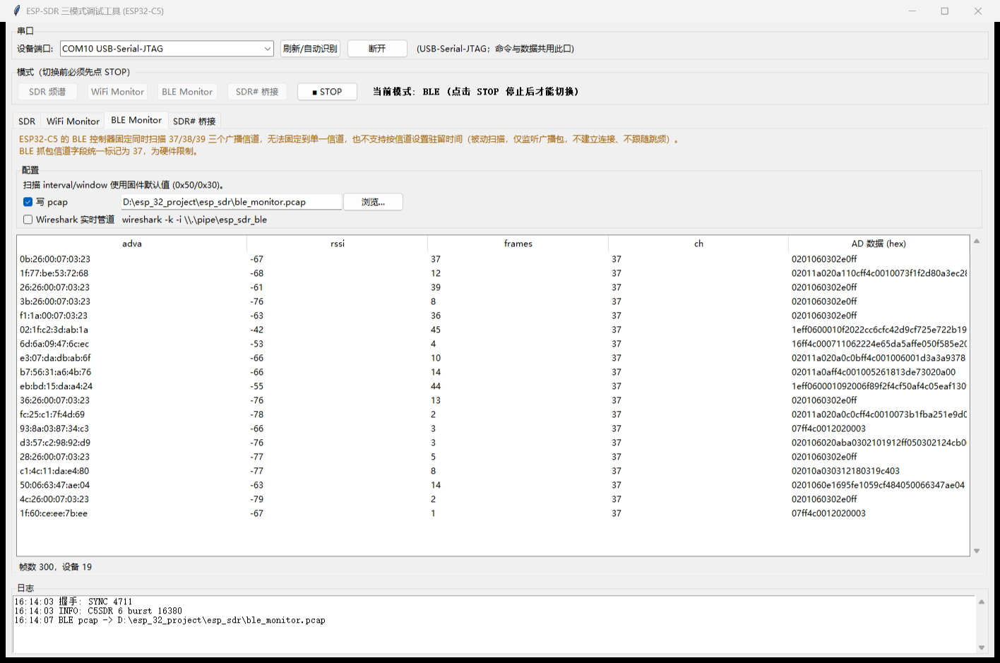

> 图：BLE Monitor。被动扫描，设备表给出 AdvA、RSSI、帧数与 AD 数据；页面上明确标注"固定扫 37/38/39、信道字段统一 37"的硬件限制。

### 第二步：把连续采样移植到 ESP-SDR

抓包做完之后，注意到 ESP32-S3／ESP32-S31 有连续采样的能力，而 zephyr_esp_sdr 已经把 ESP32-C5 的连续采样也做出来了（CPU-paced）。于是有了下一个想法：把这套移植进 ESP-SDR，解决上游 C5 只有快照（`CAP16`）的问题——采一段、停采、读回、再采，快照之间必然有间隙。

可以直接借两样东西：**用调制解调器里的 IQ estimator 做连续采样**，以及**按输出速率定速读取**。照搬到 IDF 上会撞墙：用一个高优先级任务死循环去轮询累加器，会饿死 IDLE，直接触发任务看门狗（我们实测到 `MCAUSE=0xdeadc0de`）；用 `vTaskDelay(1)` 又只有 1 ms 粒度，跟不上 20 kHz 的读取节奏。所以最终形态是：

- 硬件对 80 MHz 基带做累加（`phy_iq_est_*` 那组寄存器），窗口上限约 32768 个输入样本、每 ~350 µs 重新 arm 一次；
- 一个 **20 kHz 的 esp_timer ISR** 读累加和并差分，用"欠采样累加"合成 10k–80k 的任意整数速率，写进 PSRAM 无锁环；
- 普通任务每 4 ms 排空环，按 128 对 int32 一块送串口。

上限不在 ADC，而在 USB 串口：80 kS/s 的 int32 流约 636 kB/s，已经贴着实测上限，所以高档位必须允许丢帧并如实计数（`IQS?` 的 dropped）。

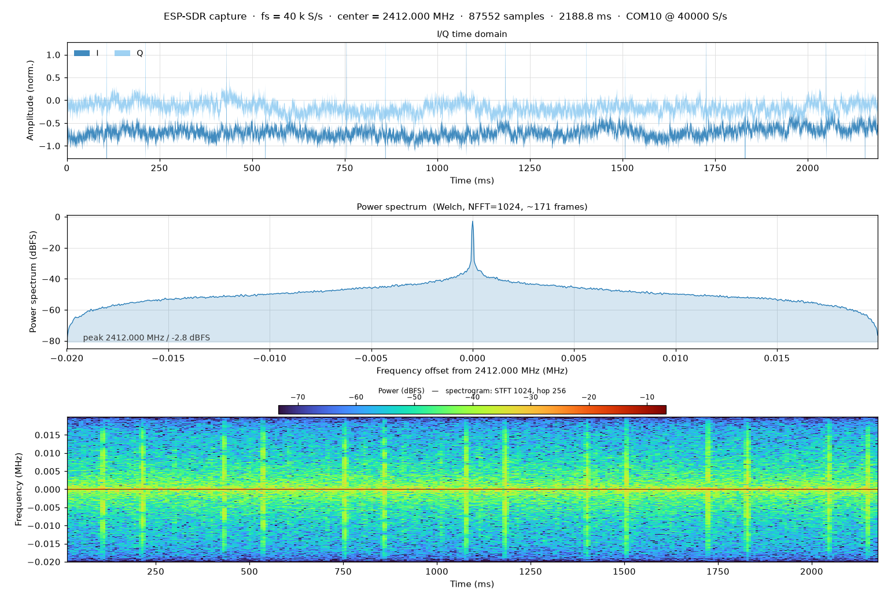

> 图：`tools/iq_analyze.py` 把录下来的连续 I/Q 画成三联图（时域 / 功率谱 / 时频热力图），用于离线看突发、找干扰、验证调制。

### 第三步：接入桌面 SDR 软件生态（SDR Bridge）

连续移植完之后又了解到 esp-sdr-bridge：它在主机侧把 ESP32 包装成标准 SDR 设备，接进 SDR++、SDR# 这些软件。这条思路正好补上"抓得到、但桌面软件用不上"的缺口。

- **为什么不照搬它**：esp-sdr-bridge 面向 S3 + 双核 DDC + rtl_tcp/SpyServer，而 C5 是单核、没有 DDC，只能给出 ≤80 kS/s 的基带；SDR# 的 RTL-TCP 采样率最低只能选 0.25 MSPS，勉强对接只会不断欠载。我们只借它"在主机侧包装"的分层，协议换成 libiio/iiod：采样率由客户端请求、主机侧做线性插值，界面就能稳定刷新，顺带把 Python/MATLAB 也接进来了。
- **属性映射**：`altvoltage0.frequency` → `FREQ`、`sampling_frequency` → `IQS`、`rf_bandwidth` → `BANDWIDTH`、`hardwaregain`/`gain_control_mode` → `GAIN MANUAL`/`GAIN HARDWARE`。
- **调谐的代价**：C5 在 IQS 流式期间拒绝 `FREQ`（PHY 被 RX 测试模式占用），所以桥接改频时是"停流 → 改频 → 重启流"，界面上表现为一次很短的断点；调谐步进也只有 1 MHz。

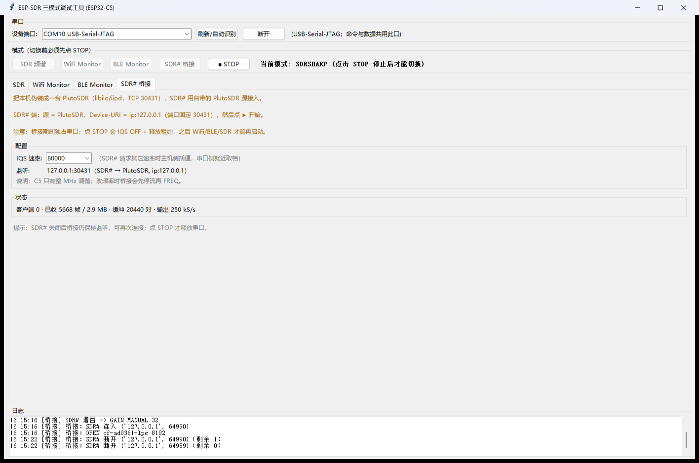

> 图：SDR# 桥接模式。GUI 内置 iiod 服务端，SDR#/libiio 客户端连上来后状态栏实时显示帧数与字节数；日志里能看到 `SDR# 连入 → OPEN cf-ad9361-lpc → GAIN MANUAL`。

### 三种数据分别在哪一层"截流"

同一条 I/Q 通路（见前文四关）在不同位置被切了一刀，得到不同用途的数据：

| 模式            | 截流位置                    | 拿到什么                        | 率                  |
| ------------- | ----------------------- | --------------------------- | ------------------ |
| SDR · 片上频谱    | dump engine 之后、固件里做 FFT | 每帧 256–2048 个功率 bin（`SPC1`） | 约 430 帧/s @80 MS/s |
| SDR · 连续 IQ   | IQ estimator 累加器        | int32 交错 I/Q，10k–80k S/s    | 最高 636 kB/s        |
| SDR · 突发 IQ   | dump engine 的 SRAM bank | 单次快照 256–16380 点（`CAP16`）   | 约 20 帧/s           |
| Wi-Fi Monitor | 802.11 协议栈的混杂回调         | Radiotap + 完整 802.11 帧      | 约 400 帧/s @繁忙 2.4G |
| BLE Monitor   | NimBLE 的被动扫描回调          | 完整广播 PDU（37/38/39）          | 约 40 帧/s @实验室      |
| SDR# 桥接       | 主机的 libiio 服务端          | int16 I/Q（由连续 IQ 插值）        | 由客户端请求速率决定         |

几条容易被忽略的细节：

- **片上频谱是"传结果不传样本"**：dump engine 把基带写进预留 SRAM，固件用 `esp-dsp` 做 FFT，只把功率 bin 送上串口——这是 80 MS/s 的芯片能在 12 Mbit 链路上出图的原因。
- **Wi-Fi 回调里只能做最轻的活**：取 RSSI／信道、拼 15 字节 Radiotap、把整帧丢进 PSRAM 帧池，组包发送交给独立任务；回调里做重处理会直接掉帧。
- **BLE 是被动扫描**：NimBLE 只收广播包，不发 `SCAN_REQ`；C5 控制器固定同时扫 37/38/39，所以 pcap 里的信道字段统一填 37（硬件限制，不是 bug）。
- **共存时的冲突点**：射频只有一个（靠"必须 STOP 才能切"强制互斥）、串口只有一个（GUI 与独立桥接进程互斥）、USB 带宽有限（高档位连续 IQ 要丢帧并计数）、内存要留在 PSRAM（内部 SRAM 有一块被 dump engine 预留，链接期就断言不许越界）。

### 怎么用

```bat
:: 1) 打开 GUI（或源码 python monitor_gui\esp_sdr_gui.py）
monitor_gui\dist\esp_sdr_gui.exe
::    选 COM10 (USB-Serial-JTAG) → 连接 → 点「SDR 频谱」→ 开始抓包
```

- **看频谱**：SDR 模式，抓包模式选「片上频谱」，频率 2412、采样率 80 MS/s；想压动态范围就展开「显示」点「自动电平」。

- **录 I/Q**：抓包模式切「IQ 传回电脑」，选「连续」或「突发」，勾「保存 IQ 原始样本」；之后
  `python tools/iq_analyze.py cap.iq --format int32 --rate 40000 --center 2412`。

- **抓 Wi-Fi/BLE 包**
  
  - 落盘：切到对应模式，勾「写 pcap」。Wi-Fi 是 Radiotap + 完整 802.11 帧（linktype 127），BLE 是完整广播 PDU（linktype 256），Wireshark 直接打开。
  
  - 实时：勾「Wireshark 实时管道」。GUI 会创建命名管道并在日志里打印
    `等待 Wireshark 连接 \\.\pipe\esp_sdr_wifi ...`，**要先让 GUI 把管道建出来，再去连 Wireshark**。
  
  - 管道建好后，在wireshark界面建立管道即可使用esp32进行抓包：
    
    ```
    \\.\pipe\esp_sdr_wifi
    ```

- **接 SDR#/libiio**：点「SDR# 桥接」→ SDR# 里源选 PlutoSDR、URI 填 `ip:127.0.0.1` → 点 ▶；
  或在 Python 里 `pip install "pylibiio==0.25"` 后跑 `examples/gui_libiio_record.py`。

### 与上游/衍生项目的关系和局限

- 与 **esp-sdr（上游）**：上游解决"原始样本能出来"；我们在此基础上加"协议层监控 + 连续采样 + 桌面软件接入"，没有改固件原有的命令语义与帧格式。
- 与 **zephyr_esp_sdr**：连续采样的思路来自它（IQ estimator + CPU-paced）；差异是我们没有用轮询任务，而是 ISR 定速（IDF 下轮询会饿死 IDLE 触发看门狗），并且只做接收侧。
- 与 **esp-sdr-bridge**：包装成标准 SDR 设备的分层来自它；但它面向 S3 的双核 DDC + rtl_tcp/SpyServer，C5 单核没有 DDC，我们换成 libiio/iiod（PlutoSDR 模拟）。
- 局限：真实带宽 ≤80 kHz（USB 串口约 640 kB/s）、C5 调谐步进 1 MHz、增益与幅度**未校准**、BLE 固定扫三信道所以信道字段恒为 37、桥接单客户端、SDR# 出频谱需要在 SDR# 里手动点一次开始（它没有命令行入口、也不自动开会话）、MATLAB 的 `sdrrx('Pluto')` 连得上但驱动自身会中止（用文件或 `iio_readdev` 代替）。
